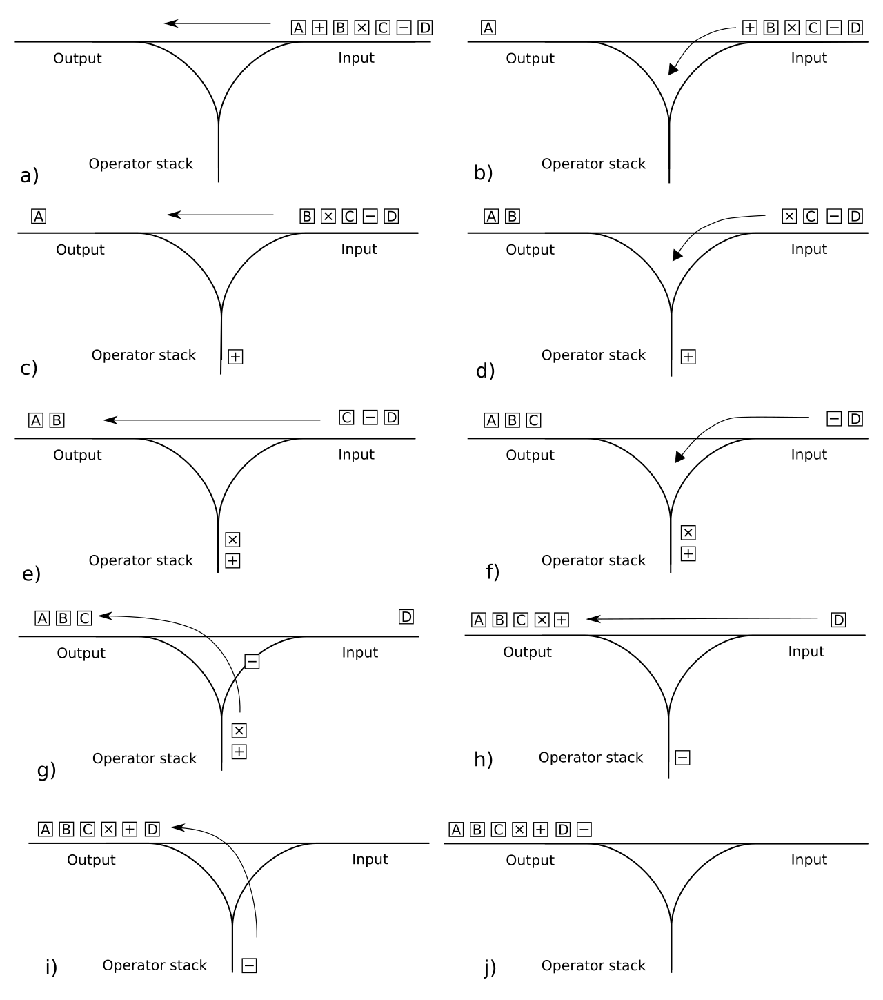

# 64-bit Integer Calculator on RISC-V

Year 2 Microcontrollers coursework.

A 64-bit integer calculator with operator precedence running on a 32-bit RISC-V processor, with a small operating system underneath that handles traps, interrupts, peripherals and user code.

It runs on a small custom microcontroller with a 16-key keypad, four on-board buttons, a 16x2 LCD, a piezo buzzer and LEDs.

## Implementation

Expressions are evaluated in two passes in [lib/calc.s](lib/calc.s):

1. `shunting_yard` converts the typed infix string to Reverse Polish Notation (RPN).
2. `evaluate_rpn` reduces the RPN to a single 64-bit result.

`3 + 4 * 2` → `RPN: 3 4 2 * +` → `11`

The parser uses an **operator stack** and an **output stack** of fixed 12-byte tokens, popping operators to the output according to their precedence. The evaluator reuses the output stack as its working stack, and either evaluates to a single 64-bit result or returns an error code.

  
   
  Diagram: <a href="https://commons.wikimedia.org/wiki/File:Shunting_yard.svg">Shunting yard.svg</a> via Wikimedia Commons, <a href="https://creativecommons.org/licenses/by-sa/3.0/">CC BY-SA 3.0</a>.

## Pages

Features a paginated user interface with a page for each mode.

### Menu

Displays a selection menu to enter other pages.

### Calculator

- **64-bit signed arithmetic** for `+`, `-`, `*` and `/`, with correct operator precedence (following BODMAS).
- **Infix expressions** are typed on a 16-key keypad, converted to Reverse Polish Notation with the shunting-yard algorithm, then evaluated.
- **Scrollable expressions:** supports complex expressions which can be scrolled through.
- **Error handling:** overflow, underflow, division by zero and internal errors (such as stack overflow).

### History

Displays the most recent 8 results, stored in memory using a circular queue.

### Testing suite

Implements 16 tests, ensuring math operations are handled correctly. Displays pass or fail for each test.

## Peripherals

| Peripheral       | Driver               | Purpose                                                                                           |
| ---------------- | -------------------- | ------------------------------------------------------------------------------------------------- |
| Timer            | `drivers/timer.s`    | Interrupts every 1 ms, and calls the keypad, button and buzzer routines at 1 ms or 5 ms intervals |
| Keypad           | `drivers/keyboard.s` | Scans the 4x4 keypad row by row                                                                   |
| On-board buttons | `drivers/buttons.s`  | Scans the four on-board buttons                                                                   |
| Keys buffer      | `drivers/keys.s`     | FIFO of pressed keys, with debounce, auto-repeat and rollover logic                               |
| LCD              | `drivers/lcd.s`      | Writes data and commands to the 16x2 display, waiting for the busy flag                           |
| Buzzer           | `drivers/buzzer.s`   | Plays one of 50 notes for a set duration in milliseconds                                          |
| LEDs             | `drivers/led.s`      | Sets the colour of the LEDs                                                                       |

The buzzer's hardware is a SystemVerilog user peripheral in `Questa/`, with a testbench that simulates bus reads and writes to it.

## OS

- **Initialisation** (`os/init.s`): sets up the machine and user stacks, initialises the peripherals, enables interrupts, and switches to user mode to start the program.
- **Trap handling** (`os/traps.s`): interrupts are handled asynchronously and preserve all registers. Exceptions are handled synchronously, so ecalls can return values.
- **System calls** (ecalls): user code uses these to reach the drivers. They are LCD write, set LEDs, get key and play sound.
- **Global constants** (`os/globals.s`): hardware addresses, register offsets, bit masks, LCD commands and timer settings.

## Libraries

- **Calculator** (`lib/calc.s`): 64-bit arithmetic (hi-lo representation), a shunting-yard parser that converts expressions to Reverse Polish Notation, and an evaluator for the result.
- **LCD utilities** (`lib/lcd.s`): writes strings, padded hex values and decimal values. Control codes include `\b` (backspace), `\t` (tab), `\n` (lower line), `\v` (upper line), `\f` (clear and reset) and `\r` (carriage return).
- **Delay** (`lib/delay.s`): `delay_ms` and `delay_loop`, which waste cycles for timing.

> [!NOTE]
> The project is written in the course's assembler syntax (`EQU`, `defb`, `include`, `ecall`). It must be compiled using bennett.
